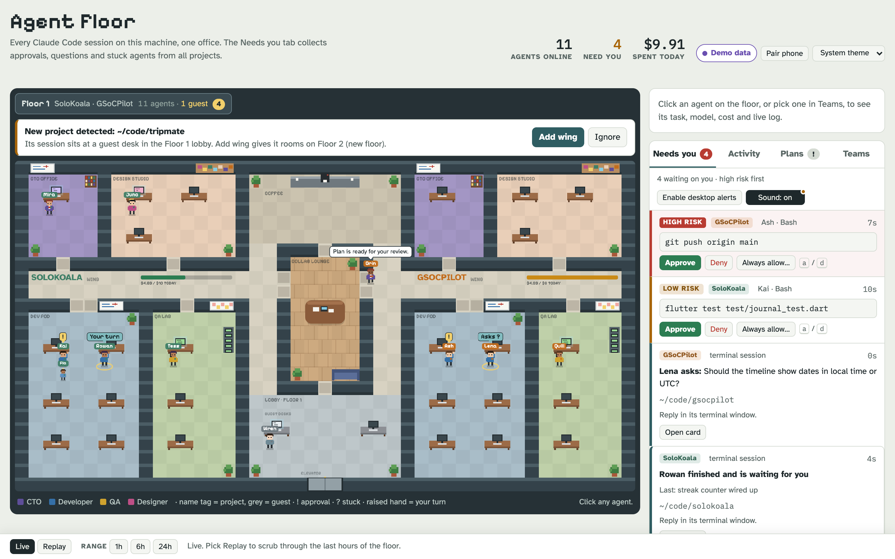
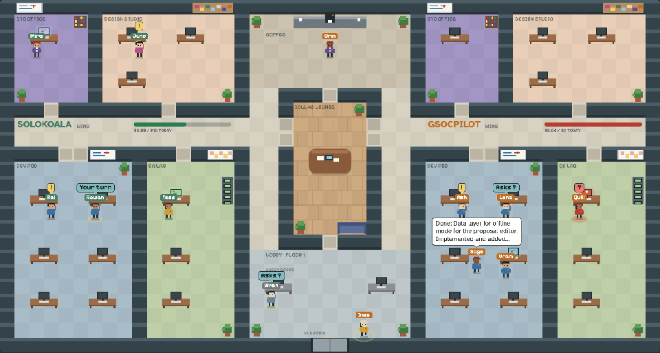
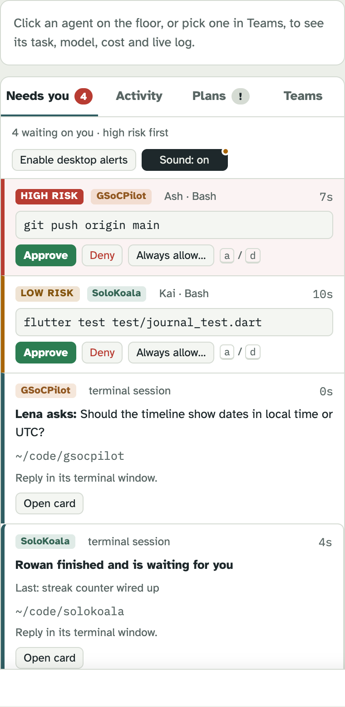
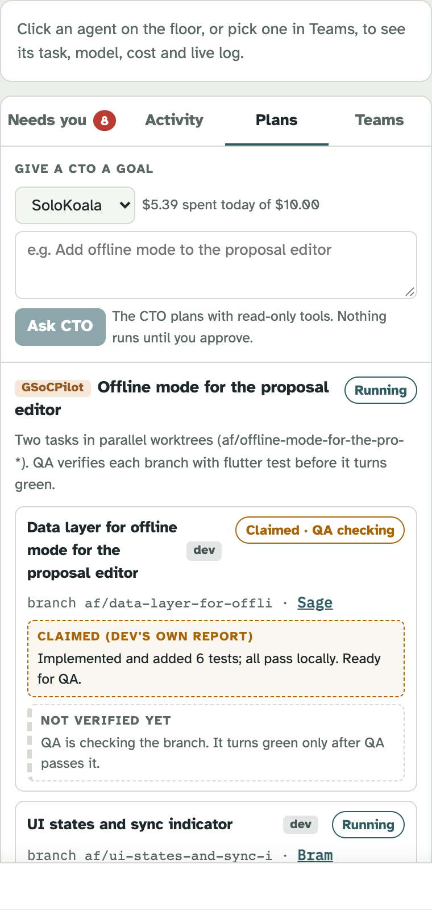
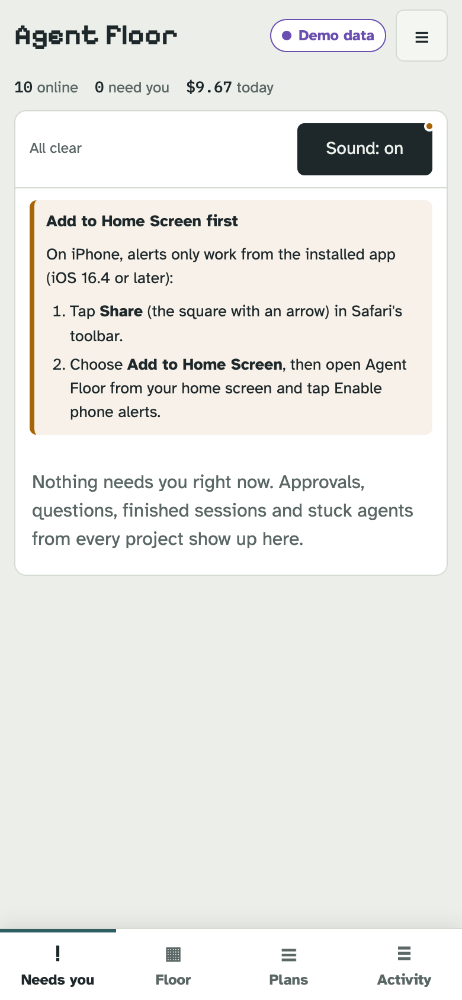
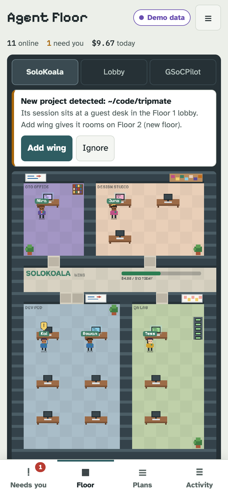
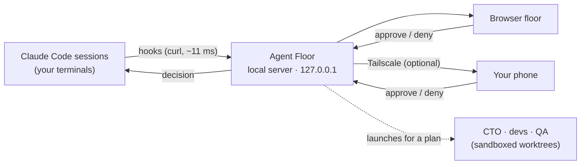

<div align="center">

# 🏢 Agent Floor

### Your Claude Code agents, in one pixel office.

**See every session. Answer what's waiting. Never miss a "Do you want to proceed?" again.**

[](#install)
[](#install)
[](#how-it-works)
[](#privacy--safety)
[](#license)

<br>

<picture>
  <source media="(prefers-color-scheme: dark)" srcset="assets/hero-dark.png">
  
</picture>

<br><br>

```bash
brew install noman2002/agent-floor/agent-floor
```

</div>

---

## Running five Claude sessions at once?

You know the routine. One terminal is waiting on a permission prompt. Another finished ten minutes ago. A third has been "thinking" for a suspiciously long time. You cycle through tabs to find out which one needs you.

**Agent Floor turns that into one screen.** Every Claude Code session on your Mac becomes a little avatar on its project's floor. Anything that's waiting on you lands in a single queue, and you can answer it from your browser, your phone, or the terminal, whichever is closest.

<div align="center">
  
  <br><sub>Each project gets a wing: CTO office, design studio, dev pod and QA lab. Agents walk where their work is.</sub>
</div>

---

## ✨ What you get

<table>
<tr>
<td width="50%" valign="top">

### 🔔 One "Needs you" queue
Permission requests, questions Claude asks you, finished turns and stuck agents from **every project, in one list**. High-risk commands like `git push` or `rm -r` sit at the top in red.

- **Approve from anywhere.** Click it in the browser and the terminal dialog closes by itself. Answer in the terminal and the browser item clears.
- **"Always allow"** for exact commands you trust, so the queue gets quieter over time.
- **High-risk commands always ask you.** No rule can auto-approve them.

</td>
<td width="50%" valign="top">

</td>
</tr>
<tr>
<td width="50%" valign="top">

</td>
<td width="50%" valign="top">

### 👩‍💼 A team per project
Give a project's **CTO agent** a goal. It reads the code and writes a plan, and nothing runs until you approve it.

- **Developers** work in parallel, each in its own sandboxed git worktree and `af/*` branch.
- **QA** runs the tests itself before anything turns green.
- **Claimed vs Verified.** You see what the dev *says* it did next to what QA *actually checked*.
- **Nothing is ever pushed or merged for you.**

</td>
</tr>
<tr>
<td width="50%" valign="top">

### 📱 Works on your phone
Pair your phone by scanning a QR code, add it to your home screen, and approve from the couch. With [Tailscale](https://tailscale.com), it works away from home too, over an encrypted link with no ports opened.

With Tailscale you can also turn on push alerts, which tell you when something high-risk is waiting even when the page is closed.

</td>
<td width="50%" valign="top">
<p align="center">

&nbsp;

</p>
</td>
</tr>
</table>

### And also
| | |
|---|---|
| ⏪ **Replay** | Scrub back through the last hours of the floor: who did what, and when. |
| 💸 **Usage & budgets** | Token use per agent and per project, with a daily budget per wing. |
| 🧭 **Stuck detection** | Agents that go silent or loop on the same command turn red, with the reason. |
| 🏗️ **Grows with you** | New repos arrive at guest desks in the lobby. **Add wing** gives them a team. Two wings per floor; more projects add floors. |
| 🔌 **Claude Code plugin** | Optional. `/agent-floor:floor` shows status right inside Claude. |

---

## 🚀 Install

```bash
brew install noman2002/agent-floor/agent-floor
```
If Homebrew asks you to trust the tap, run `brew trust noman2002/agent-floor` and then the install again.
You need **Node.js 22.5 or newer** (`brew install node`; fnm, nvm and volta also work).

## ▶️ Quick start

```bash
agent-floor start --open      # 1. opens the floor in your browser, already paired
agent-floor install-hooks     # 2. connect Claude Code (backs up your settings; undo with uninstall-hooks)
claude                        # 3. start a session in any repo and watch it walk in
```

Want to try it with no real projects first? `agent-floor demo --open` gives you a fully simulated office.

Run it at login: `brew services start agent-floor`. Check everything: `agent-floor doctor`.

---

## 🧠 How it works



Claude Code's own hooks report each event to a small local server. When Claude would show a permission dialog, the same request also appears in your queue, and the first answer from any device wins.

---

## 🔒 Privacy & safety

- **100% local.** No account and no cloud server. Your code never leaves your Mac.
- **Never slows Claude down.** If Agent Floor is off or crashed, hooks fail silently and Claude carries on as normal.
- **Approvals need a paired device.** Browsers and phones pair with one-time codes, and the floor blocks agents from contacting it.
- **Launched agents are sandboxed.** They can only write inside their own worktree, with no network access.
- **Secrets are redacted** before anything is stored. History is kept for 30 days in `~/.agent-floor`.

---

## ❓ FAQ

<details>
<summary><b>Does it cost anything?</b></summary>

Agent Floor itself is free. Agents it launches for a plan run on your own Claude Code login. The "API value" figures on the floor are estimates of token use, not charges.
</details>

<details>
<summary><b>Will it slow down Claude Code?</b></summary>

No. Each hook is a single local `curl` that adds about 11 ms. When Agent Floor isn't running, hooks exit silently and add nothing noticeable.
</details>

<details>
<summary><b>Linux or Windows?</b></summary>

macOS only for now.
</details>

<details>
<summary><b>Does it work with sessions I already have open?</b></summary>

Sessions pick up the hooks when they start, so restart sessions that were already open after running `install-hooks`.
</details>

<details>
<summary><b>How do I remove it?</b></summary>

```bash
agent-floor uninstall-hooks
brew services stop agent-floor; brew uninstall agent-floor; brew untap noman2002/agent-floor
rm -rf ~/.agent-floor
```
</details>

---

## License

Free to install and use. The source code is private. See [LICENSE](LICENSE).

<div align="center"><sub>Built for people who run too many agents at once.</sub></div>
